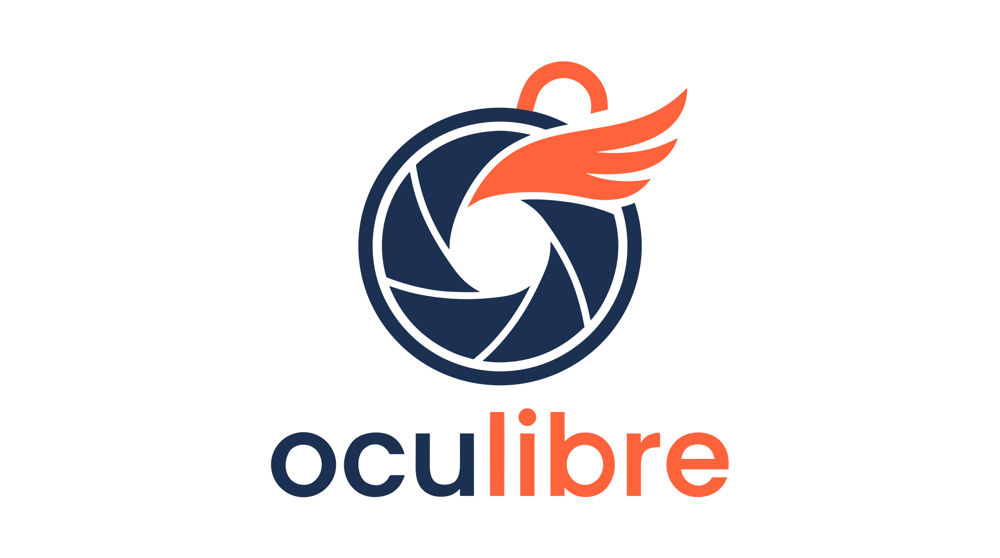
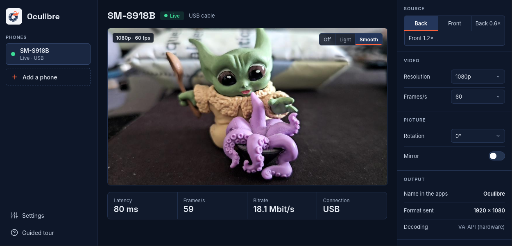
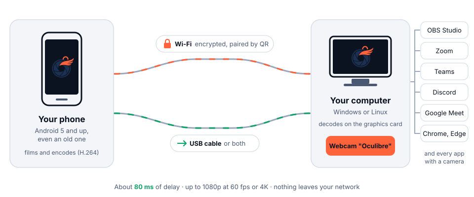
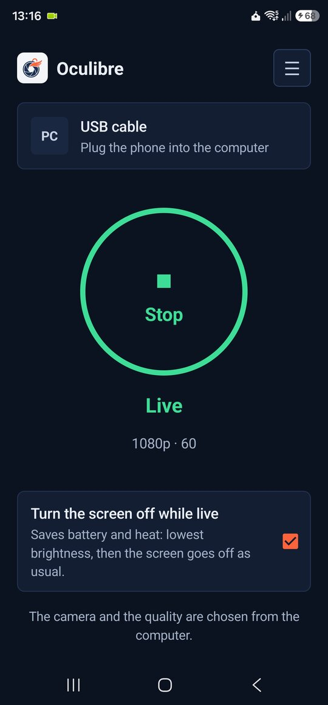
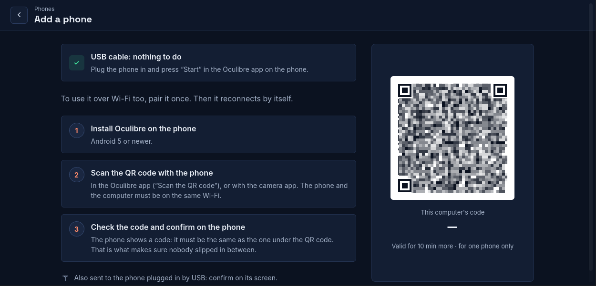
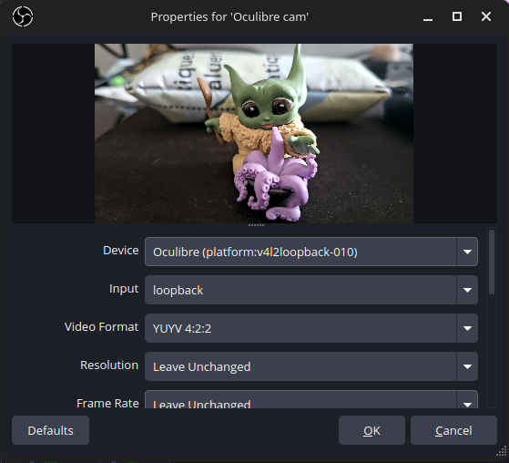

  <picture>
    <source media="(prefers-color-scheme: dark)" srcset="docs/assets/logo-title-dark.svg">
    
  </picture>

<h3 align="center">Your Android phone becomes your webcam. Free, private, even on an old phone.</h3>

  
  
  
  
  

  <a href="#download">Download</a> ·
  <a href="#how-it-works">How it works</a> ·
  <a href="#get-started">Get started</a> ·
  <a href="#status">Status</a> ·
  <a href="#contributing">Contributing</a>

  

> **En français :** Oculibre transforme un smartphone Android, même ancien, en webcam pour votre
> ordinateur, par le Wi-Fi (chiffré) ou le câble USB. Gratuit, libre, sans compte ni cloud. Les
> applications sont en français, et les contributions en français sont les bienvenues.

## Why Oculibre

The camera of the phone sleeping in your drawer is better than most webcams. Oculibre puts it to
work, in every app, without an account, a subscription or a watermark.

- **Free, for good.** Open source under the MIT licence. No ads, no "Pro" tier, no time limit.
- **Private by default.** The video goes straight from the phone to your computer, never through a
  server. Over Wi-Fi it is encrypted, and only a phone you paired with a QR code can connect.
- **Old phones welcome.** Android 5.0 and up: a second life for a phone from 2015.
- **Sharp and fast.** Up to 1080p at 60 frames per second, or 4K, with about 80 ms of delay. The
  computer decodes the video on its graphics card.
- **Works in every app.** The phone shows up as a webcam named "Oculibre" in OBS, Zoom, Teams,
  Discord, Google Meet, your browser and the Windows Camera app.
- **Made for everyone.** Installers for Windows and Linux, no terminal needed, apps in English and
  French, clear messages when something needs your attention.

## How it works

  

The phone films and compresses the video (H.264, with its own hardware). Oculibre on the computer
receives it, decodes it on the graphics card, turns it the right way up and hands it to a virtual
camera that every app sees as a real webcam. The picture is never mirrored behind your back: like a
real webcam, your call app decides how to show your self-view.

## Screenshots

<table>
  <tr>
    <td align="center" valign="top"> On the phone: one button, Start or Stop</td>
    <td align="center" valign="top"> Wi-Fi pairing: scan a QR code, once</td>
    <td align="center" valign="top"> Then pick "Oculibre" in your app, here OBS</td>
  </tr>
</table>

## Download

> Oculibre is in **beta**. It works well on the computers and phones it was tested on (see
> [Status](#status)); your reports help it work on more.

| Your device | Get it | Notes |
|---|---|---|
| **Windows 11 or 10** (64-bit) | [Installer (`.exe`)](https://github.com/Raspeur/Oculibre/releases/latest) | Installs the app and the virtual cameras. Not signed yet: Windows may warn about an unknown publisher. |
| **Ubuntu 26.04 or 24.04, Debian 13** | [Package (`.deb`) for your release](https://github.com/Raspeur/Oculibre/releases/latest) | Open it with the software centre. It brings the virtual camera module along. |
| **Fedora, Arch, other Linux** | [Build from source](desktop/README.md) | A few commands. |
| **Android 5.0 and up** | [App (`.apk`)](https://github.com/Raspeur/Oculibre/releases/latest) | Allow installing apps from your browser or file manager when Android asks. |
| macOS | Not yet | Planned ([#19](https://github.com/Raspeur/Oculibre/issues/19)). |

## Get started

**Over Wi-Fi** (recommended: nothing to turn on)

1. On the computer, open Oculibre and click **Add a phone**: a QR code appears.
2. On the phone, open Oculibre and scan it. Check that the code is the same on both screens, then
   confirm.
3. Press **Start** on the phone. Next time, opening the app is enough: it finds the computer by
   itself.

**Over the USB cable**

Turn on **USB debugging** on the phone (Settings › Developer options), plug it in, allow the
computer when the phone asks, then press **Start**.

> **About USB debugging:** it gives the computer wide access to the phone. Only allow your own
> computer, never a public one, and turn it off when you do not need it. Wi-Fi does not need it.
> This is temporary: a coming version will use the cable without developer options
> ([#21](https://github.com/Raspeur/Oculibre/issues/21)).

Then, in your app (OBS, Zoom, Teams, Meet, your browser...), choose the camera **"Oculibre"**. On
Windows 11 a second one also appears, "Oculibre" followed by "Windows Virtual Camera" in your
language: the Windows Camera app sees only that one. To use several apps at once, pick the plain
"Oculibre".

## Status

| | Works today | Coming |
|---|---|---|
| **Computer** | Windows 11 and 10; Ubuntu 26.04 and 24.04, Debian 13 (Secure Boot included) | macOS ([#19](https://github.com/Raspeur/Oculibre/issues/19)); a Flatpak with a PipeWire camera ([#25](https://github.com/Raspeur/Oculibre/issues/25)) |
| **Connection** | Wi-Fi: encrypted, QR pairing, finds the computer by itself. USB: with USB debugging | USB without developer options ([#21](https://github.com/Raspeur/Oculibre/issues/21)); pairing without a QR code ([#20](https://github.com/Raspeur/Oculibre/issues/20)) |
| **Picture** | Every camera of the phone, only the modes it really delivers, up to 4K or 1080p60; follows the phone's rotation; mirror on demand | A warning when the picture is too dark ([#8](https://github.com/Raspeur/Oculibre/issues/8)); several phones at once ([#24](https://github.com/Raspeur/Oculibre/issues/24)) |
| **Comfort** | Starts with the computer, tray icon, settings remembered for each phone | Long sessions: heat management and a "station" mode ([#6](https://github.com/Raspeur/Oculibre/issues/6)) |
| **Sound** | Not yet | A virtual microphone, later |

Measured with a Samsung Galaxy S23 Ultra over Wi-Fi on Windows 11: 80 to 86 ms of delay at 1080p60,
about 140 ms in 4K, using 5 % of the processor. The phones tested so far, with their real modes and
delays, are in [`devices/`](devices/). Yours would be welcome, old ones most of all.

## Privacy and security

- No account, no server, no telemetry. Oculibre has nowhere to send your picture but your computer.
- Over Wi-Fi the video is encrypted (TLS 1.3, or 1.2 on Android 5 to 9). The keys are exchanged by
  the QR code, so nobody else on the network can watch the stream or inject a picture, and the
  computer only accepts the phones it paired.
- Without Wi-Fi turned on in the app, the computer only listens to the USB cable.

Found a vulnerability? Please report it privately, as explained in [`SECURITY.md`](SECURITY.md).

## Contributing

You can help without writing code: **trying Oculibre on your phone and opening a
[device report](https://github.com/Raspeur/Oculibre/issues/new?template=device_report.yml)** is the
most useful contribution right now, especially with old phones.

Code is welcome too: the Android app (Kotlin), the engine and the virtual cameras (Rust), the
desktop window (TypeScript and React). Open an issue first, then read
[`CONTRIBUTING.md`](CONTRIBUTING.md) for the workflow, the commit format and how AI tools may be
used here.

| Folder | What is inside |
|---|---|
| [`android/`](android/) | The phone app (Kotlin, no library: Android's own APIs only) |
| [`desktop/`](desktop/) | The computer side (Rust): engine, command line, desktop app (Tauri), Windows virtual cameras |
| [`docs/`](docs/) | Protocol, architecture, roadmap and research notes |
| [`design/mockups/`](design/mockups/) | The screens of both apps, as clickable mockups |
| [`devices/`](devices/) | Reports of the phones tested |
| [`tests/protocol/`](tests/protocol/) | Conformance vectors shared by the Rust and Kotlin code |

## License

[MIT](LICENSE). Oculibre relies on open source components; their notices come with the apps.
